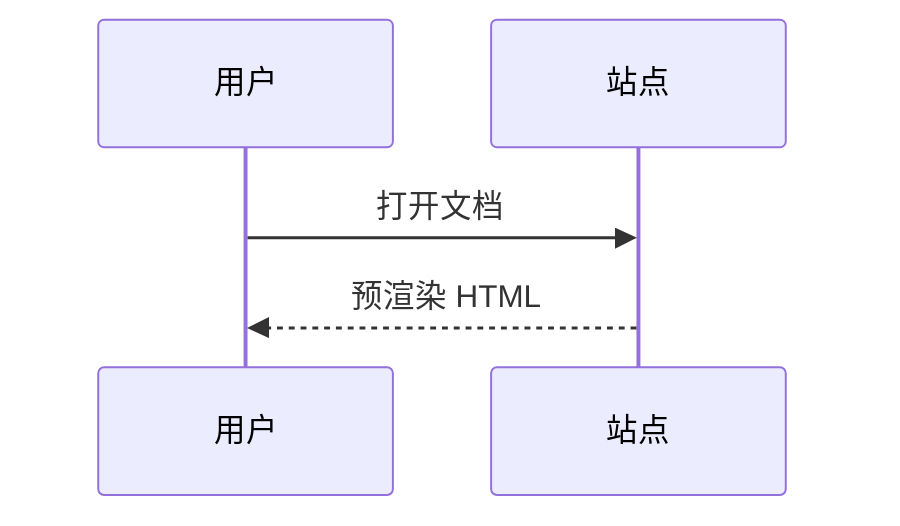

# Markdown 语法速查

## 标题

```md
# 一级标题
## 二级标题
### 三级标题
```

标题会自动生成锚点 id（保留中文），并出现在右侧目录中。

## 强调

```md
**粗体**  *斜体*  ***粗斜体***  ~~删除线~~
```

## 列表

```md
- 无序项
- 另一项
  - 嵌套项

1. 有序项
2. 第二项
```

任务列表：

```md
- [x] 已完成
- [ ] 待办
```

## 代码

行内：

```md
使用 `npm run dev` 启动。
```

块级：

````md
```ts
export const hello = (name: string) => `Hello, ${name}`;
```
````

- 写语言名才有高亮
- 行号由配置控制
- 右上角有复制按钮

## 表格

```md
| 名称 | 说明 | 默认 |
| --- | --- | --- |
| `toc_depth` | 目录层级 | 3 |
```

| 名称 | 说明 | 默认 |
| --- | --- | --- |
| `toc_depth` | 目录层级 | 3 |

对齐：

```md
| 左 | 中 | 右 |
| :--- | :---: | ---: |
| a | b | c |
```

## 链接与图片

```md
[相对链接](./目录结构.md)
[带锚点](./目录结构.md#排序规则)
[外链](https://example.com)

```

## 引用

```md
> 普通引用
> 多行引用
```

> 普通引用
> 多行引用

提示框是引用的增强写法，见 [Markdown 增强语法](../使用指南/Markdown增强.md)。

## 分隔线

```md
---
```

---

## 数学

```md
行内 $E = mc^2$

$$
\sum_{i=1}^{n} i = \frac{n(n+1)}{2}
$$
```

行内 $E = mc^2$

$$
\sum_{i=1}^{n} i = \frac{n(n+1)}{2}
$$

## 图表

````md

````


## 转义

需要显示字面量时用反斜杠：

```md
\*不是斜体\*
```

\*不是斜体\*

## 原样输出 HTML

Markdown 中可以直接写 HTML，会被保留：

```md
<kbd>Ctrl</kbd> + <kbd>K</kbd>
```

<kbd>Ctrl</kbd> + <kbd>K</kbd>

> [WARNING] HTML 只对 Markdown 文档有效。`.html` 文档走沙箱 iframe，不经过 Markdown 解析，脚本默认禁用。
